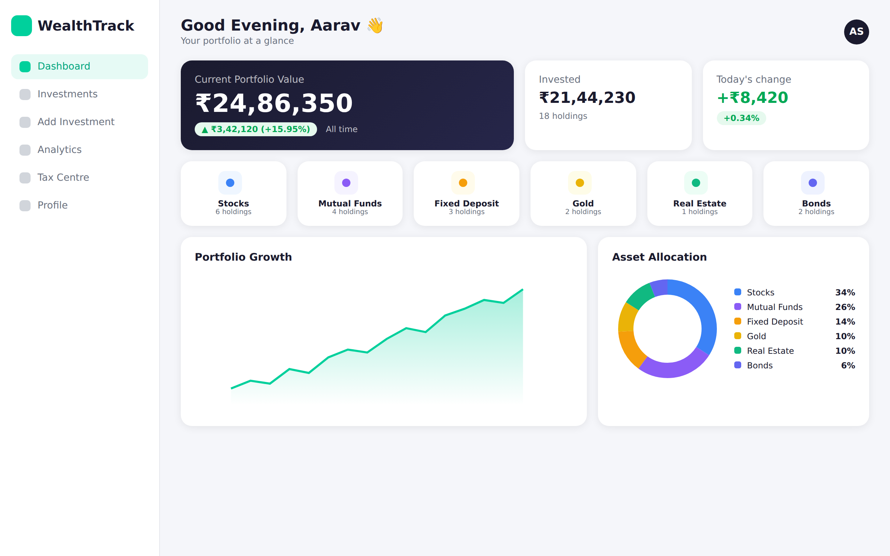
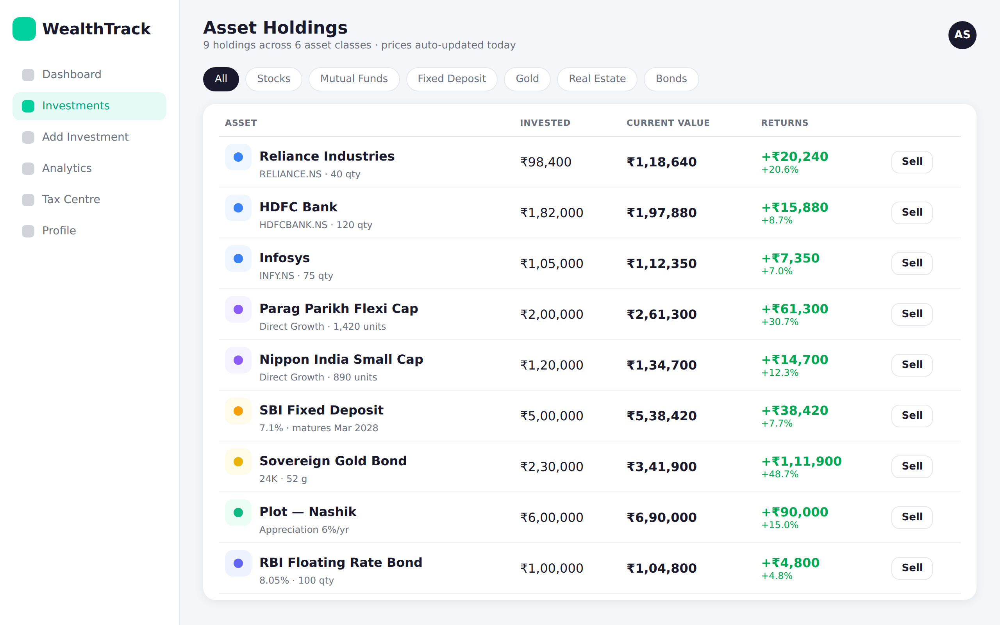
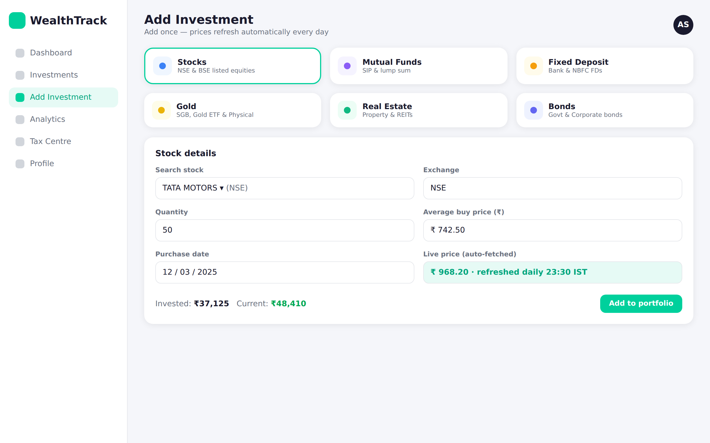
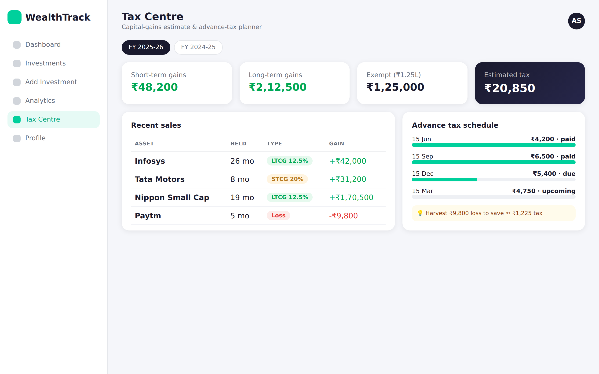

# WealthTrack — Investment Tracker (MERN)

A Groww-style investment tracker for Indian investors. Add each holding **once**; prices are then
refreshed **automatically every day**. Everything is in Indian Rupees (₹).

**Stack:** React 18 + Vite + Tailwind + Recharts · Node/Express · MongoDB (Mongoose) · JWT auth · node-cron

## Screenshots

| Dashboard | Asset Holdings |
|:---:|:---:|
|  |  |
| **Portfolio overview & allocation** | **All assets in one place** |

| Add Investment | Tax Centre |
|:---:|:---:|
|  |  |
| **Add once, prices auto-update** | **Capital gains & advance tax** |

## Quick start

You need Node 20+ and a MongoDB (local, or a free MongoDB Atlas cluster).

```bash
# 1. Backend
cd server
cp .env.example .env
#   -> set MONGODB_URI and JWT_SECRET (the server refuses to start with a missing/placeholder secret):
#      node -e "console.log(require('crypto').randomBytes(48).toString('hex'))"
npm install
npm run dev            # http://localhost:5000

# 2. Frontend (new terminal)
cd client
npm install
npm run dev            # http://localhost:3000  (proxies /api -> :5000)
```

Open http://localhost:3000, create an account, and add your first investment.

## How the daily price update works

| Asset | How the current value is kept up to date |
|---|---|
| **Stocks** (NSE/BSE) | `quantity × live price` from Yahoo Finance (`RELIANCE` → `RELIANCE.NS`, or `.BO` for BSE) |
| **Mutual funds** | `units × latest NAV` from [mfapi.in](https://www.mfapi.in) (AMFI data). You pick the exact plan via search, so the scheme code is never guessed |
| **Gold** | COMEX gold (USD/oz) × USD/INR → **₹/gram**, scaled by purity (24K/22K/18K) |
| **Fixed deposits** | Calculated from the calendar: quarterly compounding from start date, capped at maturity |
| **Bonds** | If face value, quantity and coupon are given: invested amount + accrued coupon. Otherwise manual |
| **Real estate** | Manual — or set an expected yearly appreciation % and it grows daily |

* **When:** every day at **23:30 IST** (after market close and after most NAVs are published). Change with `PRICE_UPDATE_CRON`.
* **Never miss a day:** on server start, if today's run hasn't happened yet, it runs immediately (catch-up).
* **Efficient:** each distinct stock/fund is fetched **once per run**, however many users hold it.
* **Safe:** if a price can't be fetched, the holding keeps its last value and is flagged
  "showing last known price" — it is never zeroed. It self-heals on the next run.
* **Multi-instance safe:** a MongoDB lock ensures only one instance runs the job.
* **On demand:** the *Refresh* button on the dashboard (or `POST /api/investments/refresh`) refreshes your own holdings.
  To drive the job from an external cron instead, set `ENABLE_SCHEDULER=false` and run `npm run update-prices`.
* **Growth chart:** one snapshot per user per day is stored, so the chart fills in from the day you start using the app.

## Tax Centre — capital gains on booked profit (India)

Press **Sell** on a holding to record a full or partial sale. That books the profit/loss, and the **Tax** page
estimates the tax for any financial year (FY 2024-25 onwards), shows **when and how much to pay**, and suggests ways to lower it.

| Asset (you pick the sub-type when selling) | Short-term | Long-term |
|---|---|---|
| Listed shares, equity-oriented funds | held ≤ 12 months → **20%** | > 12 months → **12.5%** on gains above **₹1.25 lakh/yr** |
| Debt funds bought on/after 1 Apr 2023 | always slab rate | — |
| Debt funds bought earlier, other funds, physical gold, property | ≤ 24 months → slab rate | > 24 months → **12.5%** (property bought before 23 Jul 2024: cheaper of 12.5% or 20% with indexation) |
| Gold ETF, listed bonds, SGB sold on exchange | ≤ 12 months → slab rate | > 12 months → **12.5%** |
| Unlisted bonds | always slab rate | — |
| SGB redeemed at maturity | exempt | exempt |

What it does for you:
* **Classifies every sale** (holding period is *more than* N months), including the pre-Feb-2018 **grandfathering** for equity.
* **Set-off of losses** the way the law allows (a long-term loss only against long-term gains; a short-term loss against either), applied to the
  highest-taxed gains first, then the ₹1.25L exemption, surcharge and 4% cess. Unabsorbed losses are shown as **carry-forward** (8 years, only if you file on time).
* **Pay-on-time helper:** tax on gains realised up to each advance-tax date (15 Jun / 15 Sep / 15 Dec / 15 Mar, plus 31 Mar for late gains), how much you've
  already paid, and what is still due. After year-end it shows the self-assessment balance.
* **Planning:** unused tax-free equity gains (with how many units you could sell), and loss-harvesting savings priced by the same engine.
* **Statement:** CSV of every sale + summary for your CA / ITR Schedule CG. A sale entered by mistake can be **undone** (the holding is restored).

**Important**
* It is an **estimate, not tax advice.** All rates, holding periods, the exemption and the Cost Inflation Index live in one file —
  [`server/config/taxRules.js`](server/config/taxRules.js). **Re-check them against the current Finance Act every year**
  (the Income-tax Act, 2025 took effect on 1 Apr 2026 and renumbers sections; this file assumes rates carry over). The CII for FY 2026-27 is
  left blank until notified; property indexation isn't evaluated for that year and the report says so.
* Only sales on or after **23 Jul 2024** are supported (older sales used different rates).
* **Purchase date matters:** it decides short vs long term, and the app defaults it to today if you left it blank when adding. The Sell dialog shows it and lets you correct it.
* One holding = one average cost and one purchase date. If you bought in several lots (or via SIP), add each lot as its own holding for accurate holding periods.
* **Not covered:** your other income and the basic-exemption adjustment, exemptions under sections 54/54EC/54F, FD/bond interest (taxed as income, not capital gains), F&O/intraday
  (business income), interest under 234B/234C, foreign assets, and AMT/HUF/company/NRI rules.

## API

All routes except register/login need `Authorization: Bearer <token>`. Errors are `{ "message": "...", "errors": [...] }`.

| Method & path | Purpose |
|---|---|
| `POST /api/auth/register` · `POST /api/auth/login` | Returns `{ token, user }` |
| `GET / PATCH /api/auth/me` | Profile (name, phone, PAN) |
| `GET /api/investments[?type=stocks]` | List holdings + `pricesUpdatedAt`, `staleCount` |
| `POST /api/investments` | Add a holding (validated per type; price applied immediately) |
| `PATCH/PUT /api/investments/:id` · `DELETE …/:id` | Edit / remove (type can't change) |
| `POST /api/investments/refresh` | Refresh your holdings now (rate limited) |
| `GET /api/investments/export.csv[?type=…]` | **CSV download** of your portfolio |
| `POST /api/investments/:id/sell` | Record a sale (full/partial) → booked gain/loss |
| `GET /api/tax/report[?fy=2026-27]` | Capital-gains tax estimate, advance-tax schedule, planning ideas |
| `PUT /api/tax/settings/:fy` | Slab rate, surcharge, tax already paid |
| `GET /api/tax/report.csv?fy=…` | Capital-gains statement (CSV) |
| `DELETE /api/tax/sales/:id` | Undo a sale (restores the holding) |
| `GET /api/portfolio/history?range=1M\|6M\|1Y\|ALL` | Daily portfolio value points |
| `GET /api/prices/mutual-funds/search?q=…` | Find a fund's scheme code |
| `GET /api/health` | Liveness |

Example — add a stock (only these fields; `current`, `dayChange`, prices are computed by the server):

```json
{ "type": "stocks", "symbol": "RELIANCE", "quantity": 10, "invested": 25000, "purchaseDate": "2024-03-15" }
```

## Security notes

* Passwords hashed with bcrypt (cost 12); login is rate limited and returns one generic error.
* JWTs are HS256-pinned; the server won't boot with a missing, short or placeholder `JWT_SECRET`.
* Every query is scoped to the signed-in user; other users' ids return 404.
* All input is validated with zod; money/price fields can't be set by the client.
* CSV export neutralises spreadsheet formula injection (`=`, `+`, `-`, `@` prefixes).
* The JWT is kept in `localStorage` (simple, but readable by any XSS). For a public deployment consider
  httpOnly cookies + CSRF protection.
* Set `TRUST_PROXY=1` behind a reverse proxy, and `CLIENT_ORIGIN` if the client is on another origin.

## Tests

```bash
cd server && npm test     # 96 tests: valuation, price providers, auth, isolation, daily job, lock, CSV, tax engine, selling
cd client && npm test     # 20 tests: real React app in jsdom against a mocked API (auth, holdings, Sell dialog, Tax Centre)
```

Server integration tests need a MongoDB at `mongodb://127.0.0.1:27017` (they use throwaway `invest-tracker-test-*` databases).

## Known limitations

* Yahoo Finance's chart endpoint is **unofficial** and can rate-limit or change without notice. Swap in a paid
  provider by editing `server/services/prices.js` (the rest of the app only sees `{ price, previousPrice }`).
* Gold is an **approximation of the domestic price** (international × FX × `GOLD_IMPORT_DUTY_PERCENT`, default 6 — verify the
  current customs duty). It excludes GST/making charges.
* FD/bond accruals are simplified (cumulative FD, quarterly compounding; coupons counted as accrued, not paid out).
* SIPs are recorded but not auto-applied: update units/amount when installments are processed.
* Only INR-priced instruments are supported; non-INR listings are rejected.
* Tax figures are only as good as the data entered (dates, amounts, sub-type) — see the Tax Centre notes above.
* The edit endpoint exists (`PATCH /api/investments/:id`) but the UI does not have an edit screen yet.
